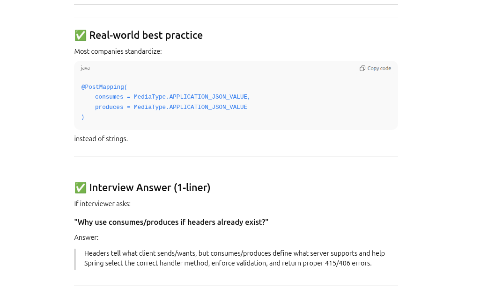

# Spring Boot Important Dependencies

## org.springframework.boot
- spring-boot-starter-web
- spring-boot-starter-security
- spring-boot-starter-validation
- spring-boot-starter-data-jpa
- spring-boot-starter-aop
- spring-boot-starter-actuator
- spring-boot-starter-test
- spring-boot-starter-hateoas
- spring-boot-devtools


## com.h2database
- h2

## com.fasterxml.jackson.dataformat
- jackson-dataformat-xml

## org.springdoc
- springdoc-openapi-starter-webmvc-ui

# Spring @RestController Quick Reference (with Annotations)

| HTTP Method                           | Annotation | Endpoint / Parameter | Description | Example |
|---------------------------------------|------------|-------------------|-------------|---------|
| GET                                   | `@GetMapping` | `/users` | Retrieve all users | `@GetMapping public List<User> getAllUsers()` |
| GET  (path variable)                  | `@GetMapping` + `@PathVariable` | `/users/{id}` | Retrieve user by ID | `@GetMapping("/{id}") public User getUser(@PathVariable int id)` |
| GET  (request parameter)              | `@GetMapping` + `@RequestParam` | `/users?role=admin` | Retrieve filtered users | `@GetMapping public List<User> getUsersByRole(@RequestParam String role)` |
| POST      (request body)              | `@PostMapping` + `@RequestBody` | `/users` | Create a new user | `@PostMapping public ResponseEntity<Void> createUser(@RequestBody @Valid User user)` |
| PUT  (full)    (pathvariable)         | `@PutMapping` + `@RequestBody` | `/users/{id}` | Full update of a user | `@PutMapping("/{id}") public ResponseEntity<User> updateUser(@PathVariable int id, @RequestBody @Valid User user)` |
| PATCH (pathvariable)(partial update/partial delete) | `@PatchMapping` + `@RequestBody` | `/users/{id}` | Partial update of a user | `@PatchMapping("/{id}") public ResponseEntity<User> patchUser(@PathVariable int id, @RequestBody Map<String,Object> updates)` |
| DELETE  (full delete)                 | `@DeleteMapping` + `@PathVariable` | `/users/{id}` | Delete a user | `@DeleteMapping("/{id}") public ResponseEntity<Void> deleteUser(@PathVariable int id)` |


---
# PATCH Example - Partial Update of a User
#### instead of map you can create DTO like userRequest better approch
| HTTP Method | Annotation | URL | Description | Example Method |
|------------|-----------|-----|------------|----------------|
| PATCH | `@PatchMapping` + `@RequestBody` | `/users/{id}` | Partially updates a user | 
```java

@PatchMapping("/{id}")
public ResponseEntity<User> patchUser(
@PathVariable int id,
@RequestBody Map<String, Object> updates) {

    User user = userService.findById(id);
    updates.forEach((k,v) -> {
        // example: only update if field exists
        if(k.equals("name")) user.setName((String)v);
        if(k.equals("email")) user.setEmail((String)v);
    });

    userService.save(user);
    return ResponseEntity.ok(user);
}
``` 

### Notes:
1. Use `@PathVariable` for URL path parameters.
2. Use `@RequestParam` for query parameters.
3. `@Valid` triggers **Bean Validation** on DTOs (`@NotNull`, `@Size`, etc.).
4. Class-level `@RequestMapping` avoids repeating the base path in every method.
5. Use `ResponseEntity` to control **status code, headers, and body**.

# Spring Boot Exception Handling Cheat Sheet

| Technique / Annotation | Purpose                                                             | Example |
|------------------------|---------------------------------------------------------------------|---------|
| `@ResponseStatus` | Set HTTP status on exception                                        | `@ResponseStatus(HttpStatus.NOT_FOUND) public class UserNotFoundException extends RuntimeException {}` |
| `@ExceptionHandler` | Handle specific exceptions in a controller or globally              | `@ExceptionHandler(UserNotFoundException.class) public ResponseEntity<ErrorDetails> handleUserNotFound(UserNotFoundException ex, WebRequest req)` |
| `@ControllerAdvice` | Global exception handler for MVC controllers                        | `@ControllerAdvice public class GlobalExceptionHandler { ... }` |
| `@RestControllerAdvice` | Global exception handler for REST controllers                       | `@RestControllerAdvice public class GlobalExceptionHandler { ... }` |
| `ResponseEntity` | Customize response body, status, and headers                        | `return new ResponseEntity<>(errorDetails, HttpStatus.NOT_FOUND);` |
| `WebRequest` | Access request details inside exception handler                     | `handleAllExceptions(Exception ex, WebRequest request)` |
| `@Valid` | Trigger Bean Validation and catch `MethodArgumentNotValidException` | `public ResponseEntity<Void> createUser(@RequestBody @Valid User user)` |
| `MethodArgumentNotValidException` | Handles validation errors automatically on DTO (eg: User)           | `@ExceptionHandler(MethodArgumentNotValidException.class)` |
| `ConstraintViolationException` | Handle validation errors on request parameters/path variable        | `@ExceptionHandler(ConstraintViolationException.class)` |
| `NoHandlerFoundException` | Handle 404 errors when no endpoint matches                          | `@ExceptionHandler(NoHandlerFoundException.class)` |
| `HttpRequestMethodNotSupportedException` | Handle 405 Method Not Allowed                                       | `@ExceptionHandler(HttpRequestMethodNotSupportedException.class)` |
| `HttpMessageNotReadableException` | Handle invalid JSON or deserialization errors                       | `@ExceptionHandler(HttpMessageNotReadableException.class)` |

---

### Example Global Handler

```java
@RestControllerAdvice
public class GlobalExceptionHandler {

    @ExceptionHandler(UserNotFoundException.class)
    public ResponseEntity<ErrorDetails> handleUserNotFound(UserNotFoundException ex, WebRequest request) {
        ErrorDetails error = new ErrorDetails(new Date(), ex.getMessage(), request.getDescription(false));
        return new ResponseEntity<>(error, HttpStatus.NOT_FOUND);
    }

    @ExceptionHandler(MethodArgumentNotValidException.class)
    public ResponseEntity<ErrorDetails> handleValidationErrors(MethodArgumentNotValidException ex) {
        String message = ex.getBindingResult().getFieldErrors()
                .stream()
                .map(e -> e.getField() + ": " + e.getDefaultMessage())
                .collect(Collectors.joining(", "));
        ErrorDetails error = new ErrorDetails(new Date(), "Validation Failed", message);
        return new ResponseEntity<>(error, HttpStatus.BAD_REQUEST);
    }

    @ExceptionHandler(Exception.class)
    public ResponseEntity<ErrorDetails> handleAllExceptions(Exception ex, WebRequest request) {
        ErrorDetails error = new ErrorDetails(new Date(), ex.getMessage(), request.getDescription(false));
        return new ResponseEntity<>(error, HttpStatus.INTERNAL_SERVER_ERROR);
    }
}


```
# Spring Boot API Versioning Cheat Sheet

| Versioning Type | V1 | V2 |
|-----------------|----|----|
| **URI Versioning** | URL: `http://localhost:8080/v1/person`<br>`@GetMapping("/v1/person") public PersonV1 getPersonV1()` | URL: `http://localhost:8080/v2/person`<br>`@GetMapping("/v2/person") public PersonV2 getPersonV2()` |
| **Request Param** | URL: `http://localhost:8080/person?version=1`<br>`@GetMapping(path="/person", params="version=1") public PersonV1 getPersonV1()` | URL: `http://localhost:8080/person?version=2`<br>`@GetMapping(path="/person", params="version=2") public PersonV2 getPersonV2()` |
| **Header Versioning** | URL: `http://localhost:8080/person/header`<br>Header: `X-API-VERSION:1`<br>`@GetMapping(path="/person/header", headers="X-API-VERSION=1") public PersonV1 getPersonV1()` | URL: `http://localhost:8080/person/header`<br>Header: `X-API-VERSION:2`<br>`@GetMapping(path="/person/header", headers="X-API-VERSION=2") public PersonV2 getPersonV2()` |
| **Content Negotiation** | URL: `http://localhost:8080/person/accept`<br>Header: `Accept:application/vnd.company.app-v1+json`<br>`@GetMapping(path="/person/accept", produces="application/vnd.company.app-v1+json") public PersonV1 getPersonV1()` | URL: `http://localhost:8080/person/accept`<br>Header: `Accept:application/vnd.company.app-v2+json`<br>`@GetMapping(path="/person/accept", produces="application/vnd.company.app-v2+json") public PersonV2 getPersonV2()` |

## 💡 Quick Summary
Do not use `@RequestParam` or `@RequestHeader` for API versioning. Use the `params` or `headers` attributes inside `@GetMapping` to let Spring handle method routing cleanly.

---

## 🎯 The Fundamental Difference

### 1. `@GetMapping(params = ...)` or `(headers = ...)`
* **Purpose:** **Routing (Request Mapping)**
* **What it does:** It tells Spring *which specific controller method* must handle the incoming HTTP request.
* **Best Used For:** API Versioning or choosing completely different business logic paths based on parameters/headers.

### 2. `@RequestParam` or `@RequestHeader`
* **Purpose:** **Data Binding**
* **What it does:** It runs *after* Spring selects the method. It extracts values directly from the request and injects them into Java variables.
* **Best Used For:** Dynamic business values like pagination variables (`?page=2`), filtering attributes (`?status=active`), or security tokens.

# API Versioning: Architectural Comparison


| Strategy | URL Readability | Cache Friendly | Documentation (Swagger)           |
| :--- | :--- | :--- |:----------------------------------|
| **URI Path** | Excellent | Yes | Out-of-the-box support (build in) |
| **Request Param** | Good | Yes | Good support                      |
| **Custom Header** | Poor (Hidden) | No (Requires `Vary`) | Requires extra configuration      |
| **Media Type** | Poor (Hidden) | No (Requires `Vary`) | Requires extra configuration      |


# Quick Note: Why Header Versioning Requires HTTP `Vary`

## 💡 The Problem
If Version 1 and Version 2 share the **exact same URL** (`GET /api/users`), network caches (browsers, CDNs) get confused.

If Client A requests Version 1 using a header, the cache saves it under the URL path. When Client B asks for Version 2 at that same URL, the cache blindly serves them the cached Version 1 data.

---

## 🛠️ The Solution: `Vary` Header
The `Vary` header forces caches to use both the **URL** AND the **Header Value** to create a unique cache key.

### Spring Boot Implementation
```java
@GetMapping(headers = "X-API-VERSION=2")
public ResponseEntity<UserDtoV2> getUsersV2() {
    return ResponseEntity.ok()
            .header(HttpHeaders.VARY, "X-API-VERSION") // Fixes caching bug
            .body(new UserDtoV2());
}
```

### Resulting Cache Keys
* `/api/users` + `X-API-VERSION: 1`
* `/api/users` + `X-API-VERSION: 2`

---

## 📋 Summary Rule
* **URI Path (`/api/v1/users`):** Caching works perfectly automatically. No `Vary` needed.
* **Header/Media Type (`/api/users`):** Strictly **requires** `Vary` to prevent data corruption bugs.

package com.in28minutes.rest.webservices.restfulwebservices.versioning;

import org.springframework.web.bind.annotation.GetMapping;
import org.springframework.web.bind.annotation.RestController;

@RestController
public class VersioningPersonController {
    
  // **When a client sends a request to: /v1/person**

    @GetMapping("/v1/person")
	public PersonV1 getFirstVersionOfPerson() {
		return new PersonV1("Bob Charlie");
	}

	@GetMapping("/v2/person")
	public PersonV2 getSecondVersionOfPerson() {
		return new PersonV2(new Name("Bob", "Charlie"));
	}
    
  // **when person?version=1"**

	@GetMapping(path = "/person", params = "version=1")
	public PersonV1 getFirstVersionOfPersonRequestParameter() {
		return new PersonV1("Bob Charlie");
	}

	@GetMapping(path = "/person", params = "version=2")
	public PersonV2 getSecondVersionOfPersonRequestParameter() {
		return new PersonV2(new Name("Bob", "Charlie"));
	}
 // **When a client sends a request with header: "X-API-VERSION=1"**

	@GetMapping(path = "/person/header", headers = "X-API-VERSION=1")
	public PersonV1 getFirstVersionOfPersonRequestHeader() {
		return new PersonV1("Bob Charlie");
	}
// **When a client sends a request with header: "X-API-VERSION=2"**
	
    @GetMapping(path = "/person/header", headers = "X-API-VERSION=2")
	public PersonV2 getSecondVersionOfPersonRequestHeader() {
		return new PersonV2(new Name("Bob", "Charlie"));
	}
    

 // **When a client sends a request with Accept: application/vnd.company.app-v1+json**

   
	@GetMapping(path = "/person/accept", produces = "application/vnd.company.app-v1+json")
	public PersonV1 getFirstVersionOfPersonAcceptHeader() {
		return new PersonV1("Bob Charlie");
	}
// **When a client sends a request with Accept: application/vnd.company.app-v2+json**

	@GetMapping(path = "/person/accept", produces = "application/vnd.company.app-v2+json")
	public PersonV2 getSecondVersionOfPersonAcceptHeader() {
		return new PersonV2(new Name("Bob", "Charlie"));
	}

}

### quick
URI versioning → simplest and most visible, but URL can get messy.

Request param versioning → clean URL, but less obvious to clients.

Header versioning → keeps URL clean, but requires headers from clients.

Content negotiation → most RESTful, supports formats, but adds complexity.


# Internationalized Hello World - Quick Reference
(local,messagersource.getMessage(key,local) ,accept-language…·   ),
| HTTP Method | URL | Header | Controller Snippet | Example Response |
|------------|-----|--------|------------------|----------------|
| GET | `http://localhost:8080/hello-world-internationalized` | `Accept-Language: nl` | 
```java
@RestController
public class HelloWorldController {

    private final MessageSource messageSource;

    public HelloWorldController(MessageSource messageSource) {
        this.messageSource = messageSource;
    }

    @GetMapping("/hello-world-internationalized")
    public String helloWorldInternationalized() {
        Locale locale = LocaleContextHolder.getLocale();
        return messageSource.getMessage("good.morning.message", null, "Default Message", locale);
    }
}
``` 


# REST API Filtering - Static vs Dynamic Cheat Sheet

| Type | How It Works | URL | Fields | Example Response | Code Snippet |
|------|-------------|-----|--------|----------------|--------------|
| Static Filtering | Fixed at compile time using Jackson annotations (`@**JsonIgnore**`, `@**JsonIgnoreProperties**`, `@**JsonProperty**`) | `/filtering` | field1, field3 | `{ "field1":"value1","field3":"value3" }` | 
```java
@JsonIgnoreProperties({"field2"})
public class SomeBean {
private String field1;
@JsonIgnore private String field2;
@JsonProperty("field_three") private String field3;
}
``` 
| Dynamic Filtering | Runtime filtering using `MappingJacksonValue` + `SimpleBeanPropertyFilter` | `/filtering-list` | field2, field3 | `[{"field2":"value2","field3":"value3"},{"field2":"value5","field3":"value6"}
**Uses @JsonFilter("SomeBeanFilter") in SomeBean class.**

**MappingJacksonValue + SimpleBeanPropertyFilter applies the filtering dynamically.**

[dynamic Filtering](/home/mukesh/IdeaProjects/spring-microservices-v3/02.restful-web-services/src/main/java/com/in28minutes/rest/webservices/restfulwebservices/filtering/FilterSpringBeanproperty.md) | 


### (use - when you have multiple words)
```
management.endpoints.web.exposure.include=*
management.endpoints.web.base-path=/manage
```
### logging
```
logging.level.org.springframework=info

--MDC (from org.slf4j.MDC) in filter we put user id (userID) to show in logger
logging.pattern.level=%5p [${spring.application.name:},%X{userID:-} %X{traceId:-},%X{spanId:-}]

MDC (Mapped Diagnostic Context) is a powerful feature provided by logging frameworks (like SLF4J, Logback, and Log4j2)
 that allows you to enrich your application log statements with contextual key-value pairs.Internally, 
MDC relies on ThreadLocal storage. This means any context data you put into MDC stays attached to 
the executing thread. Every log statement fired by that thread will automatically print those
 contextual fields without you needing to manually pass variables into your log.info() methods.
``` java

import lombok.extern.slf4j.Slf4j;
import org.springframework.stereotype.Service;

@Service
@Slf4j // ✅ Automatically injects a variable named 'log' at compile time
public class MyService {
public void doWork() {
log.debug("Lombok generated this logger instance dynamically.");
}
}
```
### application
```
server.servlet.context-path=/learn-rest
server.port=
```

## how path makes:
http://localhost:8080/{server.servlet.context-path}/{@RequestMappingURL(CLASS_LEVEL}/{@HTTPMETHOD(methodurl)}
#### api
http://localhost:8080/learn-rest/in-memory/users

#### managment end point
http://localhost:8080/learn-rest/manage

### Db configuration for h2
```
spring.datasource.url=jdbc:h2:mem:testdb
spring.jpa.defer-datasource-initialization=true
spring.jpa.show-sql=true
spring.h2.console.enabled=true

### create update table without destroying data from Entity)
spring.jpa.hibernate.ddl-auto=update
```
### my sql
```
spring.datasource.url=jdbc:mysql://localhost:3306/social-media-database
spring.datasource.username=social-media-user
spring.datasource.password=dummypassword
spring.jpa.hibernate.ddl-auto=update
spring.jpa.properties.hibernate.dialect=org.hibernate.dialect.MySQLDialect
```
### spring security
```
spring.security.user.name=admin
spring.security.user.password=admin

```
``` java
@Configuration
@EnableMethodSecurity
public class SecurityConfig {

  @Bean
  SecurityFilterChain filterChain(HttpSecurity http) throws Exception {

    http
      // 1️⃣ Stateless API → no sessions
      .sessionManagement(sm ->
        sm.sessionCreationPolicy(SessionCreationPolicy.STATELESS) (// session state maintain by JST 
      )

      // 2️⃣ CSRF disabled (JWT + REST)
      .csrf(csrf -> csrf.disable())  is not required for jWT and we are using JWT (not jseesionid )

      // 3️⃣ Endpoint security
      .authorizeHttpRequests(auth -> auth
        .requestMatchers("/public/**").permitAll()
        .requestMatchers(HttpMethod.GET, "/orders/**").hasAuthority("order:read")
        .requestMatchers(HttpMethod.POST, "/orders/**").hasAuthority("order:write")
        .anyRequest().authenticated()
      )

      // 4️⃣ JWT validation
      .oauth2ResourceServer(oauth ->
        oauth.jwt(Customizer.withDefaults())
      );

    return http.build();
  }
}

```


	//Accept (response body): (produces) application/xml  :Tells the server the format the client expects in the response.
	//Content-Type (consume) (request body): application/xml :Tells the server the format of the data being sent in the HTTP request body.


# ResponseEntity Quick Reference
## 1. Constructors

| Constructor | Description | Example |
|-------------|------------|---------|
| `ResponseEntity(T body, HttpStatus status)` | Create a response with **body** and **status code** | `new ResponseEntity<>(user, HttpStatus.OK);` |
| `ResponseEntity(MultiValueMap<String,String> headers, HttpStatus status)` | Response with **headers** and **status** but no body | `new ResponseEntity<>(headers, HttpStatus.NO_CONTENT);` |
| `ResponseEntity(T body, MultiValueMap<String,String> headers, HttpStatus status)` | Response with **body + headers + status** | `new ResponseEntity<>(user, headers, HttpStatus.CREATED);` |

---

## 2. Factory / Static Methods (Recommended)

| Method | Description | Example |
|--------|-------------|---------|
| `ok()` | 200 OK, no body | `ResponseEntity.ok().build();` |
| `ok(T body)` | 200 OK with body | `ResponseEntity.ok(user);` |
| `created(URI location)` | 201 Created with Location header | `ResponseEntity.created(URI.create("/users/1")).build();` |
| `accepted()` | 202 Accepted, no body | `ResponseEntity.accepted().build();` |
| `accepted(T body)` | 202 Accepted with body | `ResponseEntity.accepted().body(user);` |
| `noContent()` | 204 No Content | `ResponseEntity.noContent().build();` |
| `badRequest()` | 400 Bad Request | `ResponseEntity.badRequest().build();` |
| `notFound()` | 404 Not Found | `ResponseEntity.notFound().build();` |
| `status(HttpStatus)` | Any custom status | `ResponseEntity.status(HttpStatus.I_AM_A_TEAPOT).body("Oops!");` |
| `header(String key, String value)` | Add headers fluently | `ResponseEntity.ok().header("X-Custom","value").body(user);` |

---

# RestTemplate Quick Reference (Including Generic List Responses)

| Method                                                        | Description | Example                                                                                                                                                                                                                                                                             |
|---------------------------------------------------------------|-------------|-------------------------------------------------------------------------------------------------------------------------------------------------------------------------------------------------------------------------------------------------------------------------------------|
| **getForObject(url, Responseclass)**                          | GET request, returns response body directly | `User user = restTemplate.getForObject("http://localhost:8080/users/1", User.class);`                                                                                                                                                                                               |
| **getForEntity(url, Responseclass)**                          | GET request, returns `ResponseEntity<T>` (status, headers, body) | `ResponseEntity<User> response = restTemplate.getForEntity("http://localhost:8080/users/1", User.class);`                                                                                                                                                                           |
| **postForObject(url, request, Responseclass)**                | POST request, returns response body | `User created = restTemplate.postForObject("http://localhost:8080/users", newUser, User.class);`                                                                                                                                                                                    |
| **postForEntity(url, request, Responseclass)**                | POST request, returns `ResponseEntity<T>` | `ResponseEntity<User> response = restTemplate.postForEntity("http://localhost:8080/users", newUser, User.class);`                                                                                                                                                                   |
| **put(url, request)**                                         | PUT request, returns void | `restTemplate.put("http://localhost:8080/users/1", updatedUser);`                                                                                                                                                                                                                   |
| **delete(url)**                                               | DELETE request | `restTemplate.delete("http://localhost:8080/users/1");`                                                                                                                                                                                                                             |
| **exchange(url, method, Requestentity, Responseclass)**       | Generic method for any HTTP method with headers/body | HttpHeaders headers = new HttpHeaders();headers.set("Authorization", "Bearer token");HttpEntity<User> entity = new HttpEntity<>(updatedUser, headers);\nResponseEntity<User> response = restTemplate.exchange("http://localhost:8080/users/1", HttpMethod.PUT, entity, User.class); |
| **exchange(url, method, Requestentity, ParameterizedTypeReference)** | Generic method for any HTTP method with **generic collection response** | ResponseEntity<List<User>> response = restTemplate.exchange(\n    "http://localhost:8080/users",    HttpMethod.GET,    null,   new ParameterizedTypeReference<List<User>>(){});List<User> users = response.getBody();                                                               |
| **headForHeaders(url)**                                       | HEAD request, returns headers only | `HttpHeaders headers = restTemplate.headForHeaders("http://localhost:8080/users/1");`                                                                                                                                                                                               |
| **optionsForAllow(url)**                                      | OPTIONS request, returns allowed HTTP methods | `Set<HttpMethod> allowed = restTemplate.optionsForAllow("http://localhost:8080/users");`                                                                                                                                                                                            |
| **execute(url, method, requestCallback, responseExtractor)**  | Low-level, full control over request and response | ```java\nrestTemplate.execute("http://localhost:8080/users/1", HttpMethod.DELETE, null, null);\n```                                                                                                                                                                                 |

> **Tip:** For **generic responses like `List<User>`**, always use `exchange()` with `ParameterizedTypeReference<T>` because `getForObject` cannot handle generic types properly.  
> For new projects, consider **`WebClient`** instead of `RestTemplate` for reactive and non-blocking calls.
>
### WebClient vs. RestTemplate: Core Architectural Summary
```java
ResponseEntity<List<User>> response = restTemplate.exchange(
    "http://localhost:8080/users/{role}?status={status}", // 1. url (String)
    HttpMethod.GET,                                       // 2. method (HttpMethod)
    null,                                                 // 3. requestEntity (HttpEntity)
    new ParameterizedTypeReference<List<User>>(){},       // 4. responseType (ParameterizedTypeReference)
    "admin",                                              // 5. uriVariables (Object varargs - maps to {role})
    "active"                                              // 6. uriVariables (Object varargs - maps to {status})
);

List<User> users = response.getBody();
```

---
| Feature | RestTemplate | WebClient |
| :--- | :--- | :--- |
| **Architecture Style** | Synchronous / Blocking | Asynchronous / Non-blocking / Reactive |
| **Threading Model** | One thread per request (Locks thread until done) | Event-loop model (Frees thread while waiting) |
| **Spring Stack** | Spring Web (Traditional Servlet MVC) | Spring WebFlux (Modern Reactive Framework) |
| **Ecosystem Status** | **Maintenance Mode** (Legacy compatibility only) | **Active Development** (Spring's recommended standard) |
| **Resource Efficiency** | Low under high load (High memory/thread usage) | High under high load (Low memory footprint) |
| **Streaming Support** | No (Loads complete payload into memory) | Yes (Supports Server-Sent Events / `Flux` streaming) |
| **Execution Options** | Strictly blocking calls | Supports both non-blocking pipelines and `.block()` calls |


# Bean Validation Annotations Cheat Sheet

| Annotation | Target / Use | Example |
|------------|-------------|---------|
| **@NotNull** | Field must not be null | `@NotNull private String name;` |
| **@NotEmpty** | Field must not be null or empty (for Strings, Collections) | `@NotEmpty private String username;` |
| **@NotBlank** | Field must not be null, empty, or whitespace (Strings only) | `@NotBlank private String password;` |
| **@Size(min=, max=)** | Size of String, Collection, Map, or Array | `@Size(min=3, max=20) private String name;` |
| **@Min(value)** | Minimum numeric value | `@Min(18) private int age;` |
| **@Max(value)** | Maximum numeric value | `@Max(60) private int age;` |
| **@Positive** | Number must be > 0 | `@Positive private int quantity;` |
| **@PositiveOrZero** | Number must be >= 0 | `@PositiveOrZero private int stock;` |
| **@Negative** | Number must be < 0 | `@Negative private int balance;` |
| **@NegativeOrZero** | Number must be <= 0 | `@NegativeOrZero private int debt;` |
| **@Email** | Valid email format | `@Email private String email;` |
| **@Pattern(regexp=)** | Regex pattern validation | `@Pattern(regexp="\\d{10}") private String phone;` |
| **@Past** | Date must be in the past | `@Past private LocalDate birthDate;` |
| **@PastOrPresent** | Date must be in the past or present | `@PastOrPresent private LocalDate createdDate;` |
| **@Future** | Date must be in the future | `@Future private LocalDate expiryDate;` |
| **@FutureOrPresent** | Date must be in the future or present | `@FutureOrPresent private LocalDate startDate;` |
| **@AssertTrue** | Boolean must be true | `@AssertTrue private boolean acceptedTerms;` |
| **@AssertFalse** | Boolean must be false | `@AssertFalse private boolean inactive;` |
| **@DecimalMin(value)** | Minimum decimal value | `@DecimalMin("0.0") private BigDecimal price;` |
| **@DecimalMax(value)** | Maximum decimal value | `@DecimalMax("100.0") private BigDecimal discount;` |
| **@Valid** | Cascade validation to nested objects | `@Valid private Address address;` |

---

## Notes

- Use **`@Valid`** on nested objects or collections to cascade validations.
- These annotations are part of **Jakarta Bean Validation (JSR 380 / Hibernate Validator)**.
- Can be applied on **fields, method parameters, and return values**.

 
 

  
#### curl Quick Summary Table

| Method            | Syntax                                                             |
|-------------------|---------------------------------------------------------------------|
| GET               | `curl URL`                                                          |
| GET + headers     | `curl -H "Header: value" URL`                                       |
| POST              | `curl -X POST URL`                                                  |
| POST + JSON       | `curl -X POST -H "Content-Type: application/json" -d '{}' URL`      |
| POST + form       | `curl -d "key=value" URL`                                           |
| POST + file upload| `curl -F "field=@file" URL`                                         |

## Extracting Only `href` Lines from Actuator Output


### Command
```
curl -s http://localhost:8080/learn-rest/manage | jq | grep "href"

```
### output
````
"href": "http://localhost:8080/learn-rest/manage",
"href": "http://localhost:8080/learn-rest/manage/beans",
"href": "http://localhost:8080/learn-rest/manage/caches",
"href": "http://localhost:8080/learn-rest/manage/caches/{cache}",
"href": "http://localhost:8080/learn-rest/manage/health",
"href": "http://localhost:8080/learn-rest/manage/health/{*path}",
"href": "http://localhost:8080/learn-rest/manage/info",
"href": "http://localhost:8080/learn-rest/manage/conditions",
"href": "http://localhost:8080/learn-rest/manage/configprops",
"href": "http://localhost:8080/learn-rest/manage/configprops/{prefix}",
"href": "http://localhost:8080/learn-rest/manage/env/{toMatch}",
"href": "http://localhost:8080/learn-rest/manage/env",
"href": "http://localhost:8080/learn-rest/manage/loggers/{name}",
"href": "http://localhost:8080/learn-rest/manage/loggers",
"href": "http://localhost:8080/learn-rest/manage/threaddump",
"href": "http://localhost:8080/learn-rest/manage/metrics/{requiredMetricName}",
"href": "http://localhost:8080/learn-rest/manage/metrics",
"href": "http://localhost:8080/learn-rest/manage/sbom/{id}",
"href": "http://localhost:8080/learn-rest/manage/sbom",
"href": "http://localhost:8080/learn-rest/manage/scheduledtasks",
"href": "http://localhost:8080/learn-rest/manage/mappings"
````

###  convert one object to other class object
```java 
	    UserDto user = new UserDto();
	    ModelMapper modelMapper = new ModelMapper();
        UserEntity userEntity = modelMapper.map(user, UserEntity.class);
```        
#### convert string to object (read string as object)
``` java 
		 String responseBodyAsString = mvcResult.getResponse().getContentAsStrin();
        UserRest createdUser = new ObjectMapper().readValue(responseBodyAsString, UserRest.class);
```
###  object to string (write object as string)	
 ``` java 	
		new ObjectMapper().writeValueAsString(userDetailsRequestModel)		
```
	





Ultra-Quick Memory Lines

Propagation → Transaction scope

Isolation → Data visibility

Optimistic → Assume no conflict

Pessimistic → Lock early

| Propagation Level      | Quick Explanation              | When to Use (Real-Time)   |
| ---------------------- | ------------------------------ | ------------------------- |
| **REQUIRED** (default) | Join existing tx or create new | Normal service logic      |
| **REQUIRES_NEW**       | Suspend existing, start new tx | Audit logs, notifications |
| **SUPPORTS**           | Join tx if exists, else no tx  | Read-only methods         |
| **NOT_SUPPORTED**      | Run without tx                 | Long reports, exports     |
| **MANDATORY**          | Must run inside tx             | Strict business rules     |
| **NEVER**              | Must NOT run in tx             | Validation logic          |
| **NESTED**             | Savepoint inside tx            | Partial rollback          |

| Isolation Level              | Prevents               | Allows               | When to Use       |
| ---------------------------- | ---------------------- | -------------------- | ----------------- |
| **READ_UNCOMMITTED**         | Nothing                | Dirty reads          | Almost never      |
| **READ_COMMITTED** (default) | Dirty reads            | Non-repeatable reads | Most applications |
| **REPEATABLE_READ**          | Dirty + non-repeatable | Phantom reads        | Reporting         |
| **SERIALIZABLE**             | All anomalies          | None                 | Financial systems |


| Strategy        | How It Works                     | Pros                          | Cons                | Best Use Case            |
| --------------- | -------------------------------- | ----------------------------- | ------------------- | ------------------------ |
| **OPTIMISTIC**  | No lock, check version at commit | High performance, no deadlock | Retry needed        | REST APIs, microservices |
| **PESSIMISTIC** | Lock row immediately             | Strong consistency            | Blocking, deadlocks | Payments, inventory      |


| Strategy        | How It Works                     | Pros                          | Cons                | Best Use Case            |
| --------------- | -------------------------------- | ----------------------------- | ------------------- | ------------------------ |
| **OPTIMISTIC**  | No lock, check version at commit | High performance, no deadlock | Retry needed        | REST APIs, microservices |
| **PESSIMISTIC** | Lock row immediately             | Strong consistency            | Blocking, deadlocks | Payments, inventory      |

