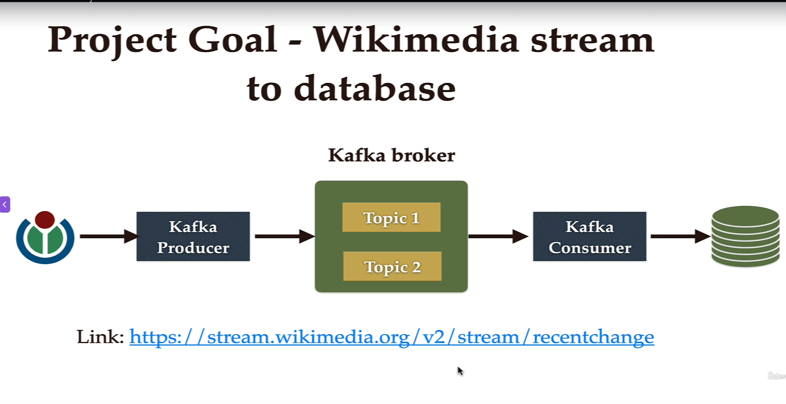
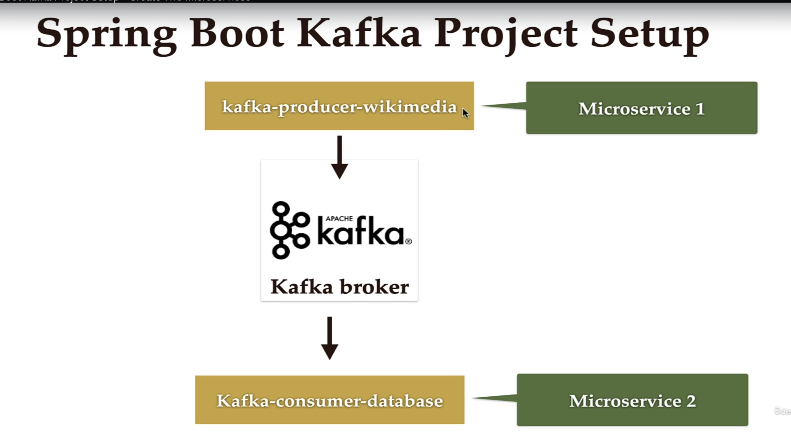
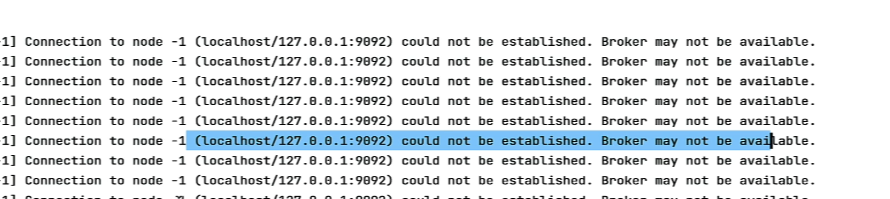
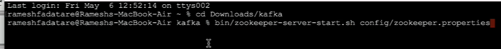
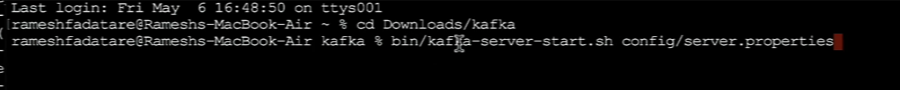
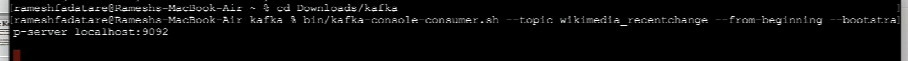

# start kafka before run the project else you will get below waring in logs 

# solution
 ## run zookeper and kafka broker.
### run zookeper

###  kafka broker


## check from commandline what kafka  is consuming from kafka topic in case you have not written Kafka consumer



# Spring Boot Kafka Real World Project

This project streams real-time Wikimedia recent changes into Kafka and persists those events into MySQL.

## Project Structure

- `kafka-producer-wikimedia`
  - Reads Wikimedia SSE stream (`recentchange`) and publishes raw JSON events to Kafka.
- `kafka-consumer-database`
  - Consumes Kafka messages and stores them in MySQL table `wikimedia_recentchange`.
- Parent module: `springboot-kafka-real-world-project` (aggregator `pom`)

## End-to-End Flow

1. `SpringBootProducerApplication` starts and runs `CommandLineRunner`.
2. `WikimediaChangesProducer.sendMessage()` opens SSE connection to:
   - `https://stream.wikimedia.org/v2/stream/recentchange`
3. `WikimediaChangesHandler.onMessage(...)` receives each event and sends it to Kafka topic `wikimedia_recentchange`.
4. `KafkaTopicConfig` ensures the topic exists at startup.
5. `KafkaDatabaseConsumer.consume(...)` listens to the same topic with consumer group `myGroup`.
6. Consumer writes each event payload into `WikimediaData.wikiEventData` (`@Lob`) via `WikimediaDataRepository`.
7. JPA/Hibernate creates/updates table schema (`ddl-auto=update`) in MySQL database `wikimedia`.

## Important Dependencies (pom)

### Parent `pom.xml`
- `spring-boot-starter`
  - Core Spring Boot runtime and auto-configuration.
- `spring-kafka`
  - Kafka producer/consumer integration (`KafkaTemplate`, `@KafkaListener`).
- `lombok`
  - Generates getters/setters in entity classes.
- `spring-boot-starter-test`, `spring-kafka-test`
  - Testing support.

### Producer module (`kafka-producer-wikimedia/pom.xml`)
- `com.launchdarkly:okhttp-eventsource`
  - SSE client used to consume Wikimedia live stream.
- `com.squareup.okhttp3:okhttp`
  - HTTP client dependency for EventSource transport.
- `jackson-core`, `jackson-databind`
  - JSON handling dependencies.

### Consumer module (`kafka-consumer-database/pom.xml`)
- `spring-boot-starter-data-jpa`
  - JPA repositories + Hibernate integration.
- `mysql:mysql-connector-java`
  - MySQL JDBC runtime driver.

## Important Configuration

### Producer config
File: `kafka-producer-wikimedia/src/main/resources/application.properties`

```properties
spring.kafka.producer.bootstrap-servers=localhost:9092
spring.kafka.producer.key-serializer=org.apache.kafka.common.serialization.StringSerializer
spring.kafka.producer.value-serializer=org.apache.kafka.common.serialization.StringSerializer
spring.kafka.topic.name=wikimedia_recentchange
```

### Consumer + DB config
File: `kafka-consumer-database/src/main/resources/application.properties`

```properties
spring.kafka.consumer.bootstrap-servers=localhost:9092
spring.kafka.consumer.group-id=myGroup
spring.kafka.consumer.auto-offset-reset=earliest
spring.kafka.consumer.key-deserializer=org.apache.kafka.common.serialization.StringDeserializer
spring.kafka.consumer.value-deserializer=org.apache.kafka.common.serialization.StringDeserializer

spring.datasource.url=jdbc:mysql://localhost:3306/wikimedia
spring.datasource.username=root
spring.datasource.password=YOUR_PASSWORD

spring.jpa.properties.hibernate.dialect=org.hibernate.dialect.MySQL8Dialect
spring.jpa.hibernate.ddl-auto=update
spring.jpa.show-sql=true
spring.kafka.topic.name=wikimedia_recentchange
```

Property details:

- `spring.kafka.consumer.group-id=myGroup`  
  Sets the consumer group name. Consumers with the same group share messages from topic partitions (load balancing). Kafka also tracks offsets per group.
- `spring.kafka.consumer.auto-offset-reset=earliest`  
  Used only when no committed offset exists for this group (new group or offset expired). `earliest` means start reading from the beginning of the topic.  
  Alternative: `latest` starts from new messages only.

## Required Configuration Changes Before Running

1. Fix typo in consumer config key:
   - Current key in project: `spring.kafka.consumer.boostrap-servers`
   - Correct key: `spring.kafka.consumer.bootstrap-servers`
2. Replace hardcoded DB password with your local password (or environment variable).
3. Ensure Kafka and MySQL are running on configured host/ports.
4. Optional cleanup: parent `pom.xml` uses `java.version=11`, while child modules compile with Java 17.
   - Prefer one consistent version across modules.

## How to Run

From project root:

```bash
cd springboot-kafka-course/springboot-kafka-real-world-project
```

1. Start Kafka broker on `localhost:9092`.
2. Start MySQL and create DB:

```sql
CREATE DATABASE wikimedia;
```

3. Start consumer first:

```bash
./mvnw -pl kafka-consumer-database spring-boot:run
```

4. Start producer in another terminal:

```bash
./mvnw -pl kafka-producer-wikimedia spring-boot:run
```

5. Verify data is being inserted:

```sql
SELECT id, wiki_event_data FROM wikimedia_recentchange ORDER BY id DESC LIMIT 10;
```

## Key Classes

### Producer
- `SpringBootProducerApplication`
  - Bootstraps app and triggers producer on startup.
- `WikimediaChangesProducer`
  - Opens SSE stream and controls lifecycle.
- `WikimediaChangesHandler`
  - Handles each incoming event and pushes to Kafka.
- `KafkaTopicConfig`
  - Creates Kafka topic bean at startup.

### Consumer
- `SpringBootConsumerApplication`
  - Starts consumer service.
- `KafkaDatabaseConsumer`
  - Kafka listener + persistence logic.
- `WikimediaData`
  - JPA entity storing event payload.
- `WikimediaDataRepository`
  - Spring Data JPA repository.

## Notes

- Producer currently runs stream for 10 minutes (`TimeUnit.MINUTES.sleep(10)`).
- Consumer stores full raw JSON payload as text (`@Lob`), which is simple and flexible for later parsing.
